# Hexagonal Architecture

This guide shows how spring-boot-cqrs fits an application built with ports and adapters (hexagonal
architecture). The application core, made of the domain and the use cases, depends on
`spring-boot-cqrs-api` at most. The parts of the library that need Spring (the core, the starters and
the broker and JDBC adapters) live in the outer ring, with the rest of the infrastructure.

<p align="center"></p>

## Table of Contents

- [The rings](#the-rings)
- [A minimal layout](#a-minimal-layout)
- [Domain](#domain)
- [Application: messages and use cases](#application-messages-and-use-cases)
- [Infrastructure: adapters](#infrastructure-adapters)
- [Composition root](#composition-root)
- [Buses belong to the outer ring](#buses-belong-to-the-outer-ring)
- [Transactions](#transactions)
- [Domain events and integration events](#domain-events-and-integration-events)
- [Request and reply between services](#request-and-reply-between-services)
- [Protecting the boundaries](#protecting-the-boundaries)
- [Describing broker messages with AsyncAPI](#describing-broker-messages-with-asyncapi)
- [Testing the use cases](#testing-the-use-cases)
- [Summary](#summary)

## The rings

| Ring | Holds | Depends on | Library module |
|---|---|---|---|
| Domain | Aggregates, value objects, domain events, repository ports | Nothing | None |
| Application | Commands and queries (input ports), handlers (use cases), output ports, result records | The domain, `spring-boot-cqrs-api` | `spring-boot-cqrs-api` |
| Infrastructure | Driving adapters (REST controllers, schedulers), driven adapters (persistence, messaging), the composition root | Everything inside it, Spring | A starter, which brings `spring-boot-cqrs-core`; `spring-boot-cqrs-jdbc`, `spring-boot-cqrs-rabbitmq` or `spring-boot-cqrs-kafka` as needed |

`spring-boot-cqrs-api` has no dependencies. It holds what a use case needs to declare and send
messages, and nothing that runs them:

- the messages: `Command`, `Query`, `Event`, `AggregateRoot` and `KeyedMessage`;
- the bus interfaces `CommandBus`, `QueryBus` and `EventBus`, and `ResultType`;
- the annotations: `@CommandHandler` and `@HandleCommand`, `@QueryHandler` and `@HandleQuery`,
  `@EventHandler` and `@HandleEvent`, `@CqrsMessage` and `@Idempotent`.

Its types keep the packages of the core (`com.borjaglez.cqrs.command`, `com.borjaglez.cqrs.query`,
...), and every starter brings the module in, so the imports are the same in every ring. The handler
annotations are not Spring stereotypes: a handler class carries no Spring annotation at all.

### Rings as packages or as modules

The rings can be packages of one Gradle module or modules of their own.

- **Packages.** The one module of the service depends on a starter, and tests keep the rings apart (see
  [Protecting the boundaries](#protecting-the-boundaries)). A violation fails a test instead of the
  compilation.
- **Modules.** The application module declares the API only, so the compiler rejects Spring and the
  core there:

```kotlin
// application/build.gradle.kts (plugin java-library)
dependencies {
    api(project(":domain"))
    api("com.borjaglez.cqrs:spring-boot-cqrs-api:0.6.0") // its messages extend Command and Query
}

// bootstrap/build.gradle.kts: infrastructure and the Spring Boot application
dependencies {
    implementation(project(":application"))
    implementation("com.borjaglez.cqrs:spring-boot-cqrs-boot4-starter:0.6.0")
}
```

The API and the core share packages, so only a module boundary can tell an API type from a core type:
a rule on package names cannot.

## A minimal layout

An `orders` service, with the rings as packages:

```text
com.example.orders
├── OrdersApplication.java                 @SpringBootApplication
├── domain
│   ├── Order.java                         aggregate
│   ├── OrderId.java, OrderLine.java       value objects (records)
│   ├── OrderEvent.java                    sealed interface of the domain events
│   ├── OrderPlaced.java                   domain event (record)
│   └── OrderRepository.java               repository port
├── application
│   ├── port/in
│   │   ├── PlaceOrder.java                Command
│   │   ├── FindOrder.java                 Query
│   │   └── OrderView.java                 result record
│   ├── port/out
│   │   ├── OrderEvents.java               tells other services what happened
│   │   └── OrderViews.java                read model
│   └── service
│       ├── PlaceOrderHandler.java         @CommandHandler
│       └── FindOrderHandler.java          @QueryHandler
└── infrastructure
    ├── in/rest/OrderController.java       sends PlaceOrder and FindOrder through the buses
    ├── out/persistence/                   JpaOrderRepository, JpaOrderViews
    ├── out/messaging/OutboxOrderEvents.java
    └── config/                            composition root

com.example.contracts.orders               a module shared with the services that consume orders
└── OrderPlacedEvent.java                  integration event
```

## Domain

The domain is plain Java. Its events are its own types, not library `Event`s:

```java
package com.example.orders.domain;

public final class Order {

  private final OrderId id;
  private final String customerId;
  private final List<OrderLine> lines;
  private final List<OrderEvent> events = new ArrayList<>();

  private Order(OrderId id, String customerId, List<OrderLine> lines) {
    this.id = id;
    this.customerId = customerId;
    this.lines = List.copyOf(lines);
  }

  public static Order place(String customerId, List<OrderLine> lines) {
    if (lines.isEmpty()) {
      throw new IllegalArgumentException("An order needs at least one line");
    }
    Order order = new Order(OrderId.newId(), customerId, lines);
    order.events.add(new OrderPlaced(order.id, customerId, order.lines, Instant.now()));
    return order;
  }

  public OrderId id() {
    return id;
  }

  public List<OrderEvent> pullEvents() {
    List<OrderEvent> pulled = List.copyOf(events);
    events.clear();
    return pulled;
  }
}
```

```java
public sealed interface OrderEvent permits OrderPlaced {}

public record OrderPlaced(OrderId orderId, String customerId, List<OrderLine> lines, Instant occurredOn)
    implements OrderEvent {}

public interface OrderRepository {
  void save(Order order);
}
```

`AggregateRoot` in the API records library `Event`s the same way. Use it when the domain may depend on
`spring-boot-cqrs-api`; a domain that stays free of the library keeps its own list, as here.

## Application: messages and use cases

Commands and queries are the input ports of the application. They extend `Command` and `Query` and
carry what the use case needs, in the language of the application:

```java
package com.example.orders.application.port.in;

public class PlaceOrder extends Command {

  private final String customerId;
  private final List<OrderLine> lines;

  public PlaceOrder(String customerId, List<OrderLine> lines) {
    this.customerId = customerId;
    this.lines = List.copyOf(lines);
  }

  public String getCustomerId() {
    return customerId;
  }

  public List<OrderLine> getLines() {
    return lines;
  }
}

public class FindOrder extends Query {

  private final String orderId;

  public FindOrder(String orderId) {
    this.orderId = orderId;
  }

  public String getOrderId() {
    return orderId;
  }
}

public record OrderView(String orderId, String customerId, String status) {}
```

These messages stay inside the service, so they need no `@CqrsMessage` and no constructor without
arguments: the in-process buses dispatch by Java type. Messages that cross a service boundary are
contracts, described in [Domain events and integration events](#domain-events-and-integration-events).

A handler is a use case. It depends on ports, never on adapters, and carries no Spring annotation:

```java
package com.example.orders.application.service;

@CommandHandler
public class PlaceOrderHandler {

  private final OrderRepository orders;
  private final OrderEvents events;

  public PlaceOrderHandler(OrderRepository orders, OrderEvents events) {
    this.orders = orders;
    this.events = events;
  }

  @HandleCommand
  public String handle(PlaceOrder command) {
    Order order = Order.place(command.getCustomerId(), command.getLines());
    orders.save(order);
    events.publish(order.pullEvents());
    return order.id().value();
  }
}

@QueryHandler
public class FindOrderHandler {

  private final OrderViews views;

  public FindOrderHandler(OrderViews views) {
    this.views = views;
  }

  @HandleQuery
  public Optional<OrderView> handle(FindOrder query) {
    return views.find(query.getOrderId());
  }
}
```

The output ports are interfaces of the application:

```java
package com.example.orders.application.port.out;

public interface OrderEvents {
  void publish(List<OrderEvent> events);
}

public interface OrderViews {
  Optional<OrderView> find(String orderId);
}
```

`PlaceOrderHandler` has no `@Transactional`: the transaction is opened by a middleware in the outer
ring (see [Transactions](#transactions)).

## Infrastructure: adapters

A driving adapter turns a request into a message and sends it through a bus interface:

```java
package com.example.orders.infrastructure.in.rest;

@RestController
@RequestMapping("/orders")
class OrderController {

  private final CommandBus commandBus;
  private final QueryBus queryBus;

  OrderController(CommandBus commandBus, QueryBus queryBus) {
    this.commandBus = commandBus;
    this.queryBus = queryBus;
  }

  @PostMapping
  ResponseEntity<String> place(@RequestBody PlaceOrderRequest request) {
    String orderId = commandBus.dispatchAndReceive(new PlaceOrder(request.customerId(), request.lines()));
    return ResponseEntity.status(HttpStatus.CREATED).body(orderId);
  }

  @GetMapping("/{id}")
  ResponseEntity<OrderView> find(@PathVariable String id) {
    Optional<OrderView> view = queryBus.ask(new FindOrder(id));
    return ResponseEntity.of(view);
  }
}
```

The consumers of `spring-boot-cqrs-rabbitmq` and `spring-boot-cqrs-kafka` are driving adapters too:
they receive a message from the broker and hand it to the same handlers.

A driven adapter implements an output port. `JpaOrderRepository` implements `OrderRepository` with
Spring Data JPA and `JpaOrderViews` implements `OrderViews`; `OutboxOrderEvents` is shown in
[Domain events and integration events](#domain-events-and-integration-events).

## Composition root

The composition root is where Spring meets the core: the auto-configuration of the starter, the
configuration classes of `infrastructure/config` and `application.yml`.

**Registration by scanning.** By default (`cqrs.handlers.scan-enabled=true`) the starter registers as
beans the classes annotated with `@CommandHandler`, `@QueryHandler` or `@EventHandler` found in the
application packages: the package of the `@SpringBootApplication` class and the packages of every
`@ComponentScan`, with their sub-packages. The adapters are ordinary components (`@Component`,
`@Repository`, `@RestController`), and Spring passes them to the handler constructors. With the layout
above, nothing else is needed. See [Handler registration](core.md#handler-registration).

**Registration by hand.** To decide in one place which use cases exist, and with which adapters, turn
the scan off and declare the handlers as beans:

```yaml
cqrs:
  handlers:
    scan-enabled: false
```

```java
package com.example.orders.infrastructure.config;

@Configuration
class OrdersConfiguration {

  @Bean
  PlaceOrderHandler placeOrderHandler(OrderRepository orders, OrderEvents events) {
    return new PlaceOrderHandler(orders, events);
  }

  @Bean
  FindOrderHandler findOrderHandler(OrderViews views) {
    return new FindOrderHandler(views);
  }
}
```

**Without Spring Boot**, annotate a configuration class with `@EnableCqrsHandlers` (in
`spring-boot-cqrs-core`), for example `@EnableCqrsHandlers(basePackageClasses = PlaceOrderHandler.class)`,
or declare the handlers as beans.

## Buses belong to the outer ring

The application sees the bus interfaces of the API. The implementations live in the core and in the
adapters, and the composition root decides which one an injection point gets:

| Interface | In process (`@Primary`) | RabbitMQ | Kafka | Transactional outbox |
|---|---|---|---|---|
| `CommandBus` | `SpringCommandBus` | `RabbitMqCommandBus` | `KafkaCommandBus` | |
| `QueryBus` | `SpringQueryBus` | `RabbitMqQueryBus` | `KafkaQueryBus` | |
| `EventBus` | `springEventBus` | `RabbitMqEventBus` | `KafkaEventBus` | `OutboxEventBus` |

Injecting `CommandBus`, `QueryBus` or `EventBus` gives the in-process bus. To send a message to
another service, declare an output port in the application and implement it in an adapter that
injects the transport's bus (see [Request and reply between services](#request-and-reply-between-services)).
A use case that sends a message to its own service, such as an event handler that dispatches a command,
can depend on the bus interface directly.

The in-process and broker buses run the middleware pipeline before the handler or before publishing;
`OutboxEventBus` runs none, and the outbound middleware runs when the relay publishes the event. See
[Dispatch pipeline](architecture.md#dispatch-pipeline). A generic result needs a `ResultType` only on a
remote bus, but passing it always keeps the call unchanged when a bus moves out of the process.

## Transactions

The handlers carry no `@Transactional`. Turn on the `TransactionMiddleware` instead, in the outer
ring:

```yaml
cqrs:
  transactions:
    enabled: true
    queries: read-only   # read-only | read-write | none
```

It needs a single `PlatformTransactionManager`, or a `@Primary` one, and runs the rest of the chain, and
so the handler, in a transaction:

- Commands and events run with `PROPAGATION_REQUIRED`: they join a transaction in progress or start one.
- Queries follow `cqrs.transactions.queries`: a read-only transaction (the default), a read-write one,
  or none at all for a query handler that calls another service and must not hold a connection.
- What the handler does through its ports joins that transaction: the repository writes, the row that
  `OutboxEventBus` inserts and, with `spring-boot-cqrs-jdbc`, the marker of an `@Idempotent` handler.
  A failure rolls all of them back and is rethrown as it is.
- `TransactionMiddleware.ORDER` is `Ordered.LOWEST_PRECEDENCE - 50`, inside the opt-in
  `RetryMiddleware` (`LOWEST_PRECEDENCE - 100`): every retry attempt gets a new transaction.
- It runs in local dispatches and in the consumers of RabbitMQ and Kafka, not on the sending side of a
  remote bus. All the handlers of one event share one transaction.

See [TransactionMiddleware](middleware.md#transactionmiddleware) and
[Transactions Properties](configuration.md#transactions-properties).

## Domain events and integration events

A domain event belongs to its service: it uses domain types and can change with the model. Other
services need a stable contract instead, an integration event:

- it lives in a contracts module shared by the producer and its consumers;
- it extends `Event`, has a `@CqrsMessage` name, a constructor without arguments and plain fields;
- it is translated from the domain event in a driven adapter, and published through
  `OutboxEventBus` in the transaction of the use case.

```java
package com.example.contracts.orders;

@Getter
@NoArgsConstructor
@AllArgsConstructor
@CqrsMessage(service = "orders", module = "order", name = "order-placed")
public class OrderPlacedEvent extends Event implements KeyedMessage {

  private String orderId;
  private String customerId;
  private List<Item> items;

  @Override
  public String messageKey() {
    return orderId; // Kafka keeps the events of one order in order
  }

  public record Item(String sku, int quantity) {}
}
```

```java
package com.example.orders.infrastructure.out.messaging;

@Component
class OutboxOrderEvents implements OrderEvents {

  private final OutboxEventBus outbox;

  OutboxOrderEvents(OutboxEventBus outbox) {
    this.outbox = outbox;
  }

  @Override
  public void publish(List<OrderEvent> events) {
    for (OrderEvent event : events) {
      switch (event) {
        case OrderPlaced placed -> outbox.publish(toContract(placed));
      }
    }
  }

  private static OrderPlacedEvent toContract(OrderPlaced placed) {
    List<OrderPlacedEvent.Item> items =
        placed.lines().stream()
            .map(line -> new OrderPlacedEvent.Item(line.sku(), line.quantity()))
            .toList();
    return new OrderPlacedEvent(placed.orderId().value(), placed.customerId(), items);
  }
}
```

`OutboxEventBus.publish` inserts a row in `cqrs_outbox` and fails with `IllegalStateException` without
an active transaction; with `cqrs.transactions.enabled=true` the `TransactionMiddleware` provides one.
The row commits with the order or not at all, and the relay publishes it after commit through the
transport's event bus, at least once. Enable the outbox with `cqrs.outbox.enabled=true`, make the
consumers `@Idempotent`, and list the contract packages in `cqrs.aot.message-packages`: the relay then
reads pending rows by their logical name, so a contract class can be renamed or moved while rows wait.
See [Transactional Outbox](outbox.md).

The domain events do not leave the service. When another use case of the same service must react to
one, call it from the handler, or publish an application event through the injected `EventBus` (the
in-process `springEventBus`, which delivers it after commit).

## Request and reply between services

The calling side declares an output port with its own types, and an adapter translates it into the
contract and sends it over the broker:

```java
package com.example.orders.application.port.out;

public interface StockGateway {
  boolean reserve(OrderId orderId, List<OrderLine> lines);
}
```

```java
package com.example.orders.infrastructure.out.messaging;

@Component
class RabbitMqStockGateway implements StockGateway {

  private final RabbitMqCommandBus commandBus;

  RabbitMqStockGateway(RabbitMqCommandBus commandBus) {
    this.commandBus = commandBus;
  }

  @Override
  public boolean reserve(OrderId orderId, List<OrderLine> lines) {
    List<ReserveStock.Item> items =
        lines.stream().map(line -> new ReserveStock.Item(line.sku(), line.quantity())).toList();
    Reservation reservation = commandBus.dispatchAndReceive(new ReserveStock(orderId.value(), items));
    return reservation.accepted();
  }
}
```

The answering side receives the contract in a handler of its application ring. A business "no" is a
result, never an exception:

```java
@CommandHandler
public class ReserveStockHandler {

  private final StockLevels stock;

  public ReserveStockHandler(StockLevels stock) {
    this.stock = stock;
  }

  @HandleCommand
  public Reservation handle(ReserveStock command) {
    return stock.reserve(command.getOrderId(), command.getItems())
        ? new Reservation(true, null)
        : new Reservation(false, "no stock");
  }
}

public record Reservation(boolean accepted, String reason) {} // in the contracts module
```

The exception itself does not cross the broker. Over RabbitMQ the caller gets a
`RemoteHandlerException`, which keeps only the name of the exception class
(`getRemoteExceptionType()`) and its message; over Kafka, a `RuntimeException` with the message. When
no reply arrives in time (`RemoteReplyTimeoutException` over RabbitMQ), the handler may still run or
may have run: make it idempotent on a business key such as the order id, because a command sent again
is a new message with a new id, which `@Idempotent` does not recognise. See
[Request and reply](rabbitmq-adapter.md#request-and-reply) for RabbitMQ and
[Request/Reply](kafka-adapter.md#requestreply) for Kafka.

## Protecting the boundaries

`spring-boot-cqrs-test` ships `CqrsArchitectureRules`, reusable [ArchUnit](https://www.archunit.org/)
rules. ArchUnit is a `compileOnly` dependency of the module: add `com.tngtech.archunit:archunit-junit5`
to the test classpath. Together with two rules of your own for the rings:

```java
@AnalyzeClasses(packages = "com.example.orders", importOptions = ImportOption.DoNotIncludeTests.class)
class ArchitectureTest {

  @ArchTest
  static final ArchRule handlersDoNotDependOnSpring = CqrsArchitectureRules.handlersDoNotDependOnSpring();

  @ArchTest
  static final ArchRule handlerMethodsInHandlers = CqrsArchitectureRules.handlerMethodsAreInHandlerClasses();

  @ArchTest
  static final ArchRule messagesAreFrameworkFree = CqrsArchitectureRules.messagesDoNotDependOnFrameworks();

  @ArchTest
  static final ArchRule domainIsPlainJava =
      noClasses().that().resideInAPackage("..domain..")
          .should().dependOnClassesThat()
          .resideInAnyPackage("..application..", "..infrastructure..", "com.borjaglez.cqrs..",
              "org.springframework..", "jakarta.persistence..");

  @ArchTest
  static final ArchRule applicationIgnoresInfrastructure =
      noClasses().that().resideInAPackage("..application..")
          .should().dependOnClassesThat()
          .resideInAnyPackage("..infrastructure..", "org.springframework..", "jakarta.persistence..");
}
```

The rules for messages that cross a service boundary belong to the contracts module: the in-process
messages of the service need neither a `@CqrsMessage` nor a constructor without arguments.

```java
@AnalyzeClasses(packages = "com.example.contracts")
class ContractsArchitectureTest {

  @ArchTest
  static final ArchRule named = CqrsArchitectureRules.messagesAreAnnotatedWithCqrsMessage();

  @ArchTest
  static final ArchRule deserializable = CqrsArchitectureRules.messagesHaveANoArgConstructor();

  @ArchTest
  static final ArchRule plainData = CqrsArchitectureRules.messagesDoNotDependOnFrameworks();
}
```

`handlersDoNotDependOnSpring()` is what keeps `@Transactional`, `@Component` and Spring types out of
the use cases. The package rules cannot tell an API type from a core type, since both share the
`com.borjaglez.cqrs` packages; make the application a module of its own when that must be enforced.
See [Architecture rules](testing.md#architecture-rules).

## Describing broker messages with AsyncAPI

The contracts are the published language of the service. Describe the messages it sends and receives
in an [AsyncAPI 3.0](https://www.asyncapi.com/docs/reference/specification/v3.0.0) document, whose
message names are the logical names of `@CqrsMessage` (`orders.1.event.order.order-placed`), and
let `spring-boot-cqrs-asyncapi-test` check the Java classes against it:

```java
@SpringBootTest
class OrdersContractTest {

  private static final AsyncApiContract CONTRACT = AsyncApiContract.fromClasspath("asyncapi/orders.yaml");

  @Autowired MessageSerializer serializer;
  @Autowired MessageNamingStrategy naming;
  @Autowired CqrsIntrospection introspection;

  private AsyncApiVerifier verifier() {
    return AsyncApiVerifier.of(CONTRACT, serializer, naming)
        .sample(new OrderPlacedEvent("order-1", "customer-1", List.of(new OrderPlacedEvent.Item("sku-1", 2))))
        .sample(new ReserveStock("order-1", List.of(new ReserveStock.Item("sku-1", 2))))
        .sample("reservation", new Reservation(false, "no stock")); // a reply: the contract names it
  }

  @Test
  void payloadsMatchTheContract() {
    verifier().verifyPayloads();
  }

  @Test
  void everyContractMessageIsSampled() {
    verifier().verifyCoverage();
  }

  @Test
  void payloadSchemasRejectUnknownFields() {
    verifier().verifyClosedSchemas();
  }

  @Test
  void receivedMessagesHaveHandlers() {
    verifier().verifyHandlers(introspection);
  }
}
```

The samples are serialized with the application's own `MessageSerializer` and named with its
`MessageNamingStrategy`, so the test sees what goes on the wire. See
[AsyncAPI Contracts](asyncapi.md).

## Testing the use cases

A handler is a plain class: test it with fakes of its ports, without Spring.

```java
@Test
void placingAnOrderTellsOtherServices() {
  InMemoryOrders orders = new InMemoryOrders();
  RecordingOrderEvents events = new RecordingOrderEvents();
  PlaceOrderHandler handler = new PlaceOrderHandler(orders, events);

  String orderId = handler.handle(new PlaceOrder("customer-1", List.of(new OrderLine("sku-1", 2))));

  assertThat(orders.contains(orderId)).isTrue();
  assertThat(events.published()).singleElement().isInstanceOf(OrderPlaced.class);
}
```

`InMemoryOrders` and `RecordingOrderEvents` are fakes written for the test. To run a handler through the
registry and the middleware pipeline, use `@CqrsTest` with `@Import`; see [Testing](testing.md).

## Summary

| Hexagonal concept | With spring-boot-cqrs |
|---|---|
| Input port | A `Command` or `Query` subclass in the application |
| Use case | A `@CommandHandler`, `@QueryHandler` or `@EventHandler` class in the application |
| Output port | An interface of the application (repositories may live in the domain) |
| Driving adapter | A controller, scheduler or listener that sends through `CommandBus` or `QueryBus`; the RabbitMQ and Kafka consumers |
| Driven adapter | An implementation of an output port, using `OutboxEventBus`, `RabbitMqCommandBus`, `KafkaEventBus`, JPA... |
| Composition root | The starter's auto-configuration, the handler scan or `@Bean` methods, `application.yml` |
| Transaction boundary | `TransactionMiddleware` (`cqrs.transactions.enabled=true`) |
| Published language | Integration events and commands in a contracts module, named with `@CqrsMessage`, described in AsyncAPI |
| Boundary checks | `CqrsArchitectureRules`, `AsyncApiVerifier` |
